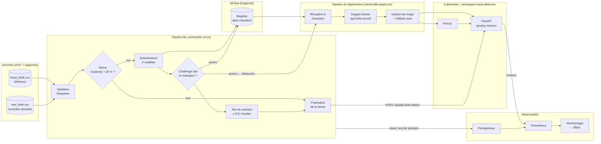

# 🛡️ Détection de fraude bancaire — plateforme MLOps

[](https://fastapi.tiangolo.com/)
[](https://nextjs.org/)
[](https://dvc.org/)
[](https://mlflow.org/)
[](https://www.jenkins.io/)
[](https://kubernetes.io/)
[](https://prometheus.io/)
[](https://www.evidentlyai.com/)

Plateforme de bout en bout pour **détecter les transactions frauduleuses sur cartes bancaires** :
données versionnées avec DVC, expériences suivies dans MLflow, ré-entraînement déclenché par la
dérive des données, promotion contrôlée du modèle (champion / challenger), déploiement sur
Kubernetes et supervision par Prometheus.

Le dépôt sert aussi de fil rouge au **cours MLOps** dont le support compilé est
[`slides/main.pdf`](slides/main.pdf) (Beamer, 14 sections, 194 pages).

---

## Sommaire

1. [Architecture](#️-architecture)
2. [Démarrage rapide](#-démarrage-rapide)
3. [**Guide complet : installer, configurer, exécuter**](#-guide-complet)
4. [Structure du dépôt](#-structure-du-dépôt)
5. [Cycle de vie du modèle](#-cycle-de-vie-du-modèle)
6. [API](#-api)
7. [Monitoring et alertes](#-monitoring-et-alertes)
8. [Déploiement Kubernetes (aide-mémoire)](#️-déploiement-kubernetes-aide-mémoire)
9. [Sécurité](#-sécurité)
10. [Configuration (référence des variables)](#️-configuration-référence-des-variables)
11. [Limites connues](#️-limites-connues)
12. [Améliorations de cette version](#-améliorations-de-cette-version)

---

## 🏗️ Architecture



Trois flux à retenir :

* **Données → modèle** : la dérive déclenche l'entraînement, mais un nouveau modèle n'est promu
  que s'il bat le champion, puis seulement s'il passe le test de scénario.
* **Modèle → production** : le pipeline de déploiement prend le modèle dans le **registre MLflow**
  (alias `champion`), pas dans un fichier local, et produit des images au tag immuable.
* **Production → supervision** : l'API expose ses métriques à Prometheus ; les résultats de CI
  passent par le Pushgateway ; Alertmanager prévient sur Slack.

---

## 🚀 Démarrage rapide

Le dépôt ne contient **ni données, ni modèle** : la première fois, tout est produit à partir
du jeu de données Kaggle par les notebooks ([étape 5](#5-produire-les-données-et-le-modèle-notebooks)) ;
ensuite, les autres machines récupèrent le résultat avec DVC.

**Première fois** (essai local, sans compte : MLflow enregistre dans `mlflow.db`) :

```bash
python3.12 -m venv .venv && source .venv/bin/activate
pip install -r requirements.txt               # inclut jupyterlab et evidently
cp .env.example .env                          # vider MLFLOW_TRACKING_URI ; QUICK_RUN=1 pour aller vite
# fraudTrain.csv (Kaggle) -> data/raws/fraud_1M.csv : voir l'étape 5.1
jupyter lab notebooks/                        # exécuter 01 -> 02 -> 03 -> 04
docker compose up -d --build                  # http://localhost:3000
```

**Machines suivantes** (données et modèle déjà versionnés sur DagsHub,
détails à l'[étape 3](#3-configurer-les-accès-et-récupérer-les-données)) :

```bash
python3.12 -m venv .venv && source .venv/bin/activate
pip install -r requirements.txt
cp .env.example .env                          # compléter DAGSHUB_* et MLFLOW_*
dvc remote modify origin url https://dagshub.com/<utilisateur-dagshub>/<depot-dagshub>.dvc
dvc remote modify origin --local auth basic
dvc remote modify origin --local user <utilisateur-dagshub>
dvc remote modify origin --local password <token-dagshub>
dvc pull artifacts/preprocessing/ artifacts/mlflow/Best_Fraud_LightGBM/
docker compose up -d --build                  # http://localhost:3000
```

> Les valeurs entre `<…>` (comptes DagsHub et Docker Hub) sont **à compléter** : le dépôt n'en
> contient aucune par défaut. Liste des fichiers concernés : [étape 7.4](#7-installer-jenkins-et-les-deux-pipelines).

---

## 📘 Guide complet

| Je veux… | Étapes |
|---|---|
| mettre en place le dépôt la première fois (données et modèle produits de zéro) | [1](#1-installer-les-outils) → 3, puis [5](#5-produire-les-données-et-le-modèle-notebooks) |
| tester l'API et l'interface sur mon poste | 1 → [4](#4-lancer-et-vérifier-en-local) (données déjà versionnées ; sinon d'abord 5) |
| rejouer l'étude (notebooks) et produire un nouveau modèle | 1 → 3, puis 5 |
| déployer sur Kubernetes avec la supervision | 1 → 4, puis [6](#6-déployer-sur-kubernetes) |
| faire tourner la boucle MLOps complète (dérive → ré-entraînement → déploiement) | 1 → 4, 6, [7](#7-installer-jenkins-et-les-deux-pipelines), [8](#8-démonstration-de-bout-en-bout) |
| exploiter, revenir en arrière, nettoyer | [9](#9-exploitation-au-quotidien), [dépannage](#10-dépannage) |

### 1. Installer les outils

| Outil | Version | Utilisé pour |
|---|---|---|
| Git | récente | tout |
| Python | **3.12** (3.11 accepté) | notebooks, API, tests, scripts Jenkins |
| Node.js | 18 ou plus | frontend hors Docker |
| Docker + Docker Compose v2 | récente | `docker compose`, images, conteneur Jenkins |
| minikube, kubectl, Helm 3 | récentes | Kubernetes et supervision (étapes 6 à 8) |
| `envsubst` | — | configuration d'Alertmanager (macOS : `brew install gettext`) |

Comptes nécessaires : **Kaggle** (données sources, étape 5), **DagsHub** (données DVC et serveur
MLflow), **Docker Hub** (images, étape 6), **Slack** (webhook d'alertes, facultatif).

> macOS : LightGBM et XGBoost ont besoin d'OpenMP → `brew install libomp`.

### 2. Récupérer le dépôt et créer l'environnement Python

```bash
git clone https://github.com/<user>/<repo>.git && cd <repo>
python3.12 -m venv .venv
source .venv/bin/activate                 # Windows : .venv\Scripts\activate
pip install --upgrade pip
pip install -r requirements.txt           # ML, API, MLflow, DVC, pytest
python -c "import lightgbm, xgboost, catboost, mlflow; print('OK')"
```

### 3. Configurer les accès et récupérer les données

**3.1 — Le fichier `.env`** (jamais commité) :

```bash
cp .env.example .env
```

| Variable | Valeur | Nécessaire pour |
|---|---|---|
| `DAGSHUB_USER`, `DAGSHUB_REPO` | votre compte et votre dépôt DagsHub | DVC et MLflow distants |
| `DAGSHUB_TOKEN` | DagsHub › *Settings* › *Tokens* | idem |
| `MLFLOW_TRACKING_URI` | `https://dagshub.com/<user>/<repo>.mlflow` — **vide = MLflow local** (`mlflow.db` + `mlruns/`) | notebooks, scripts `jenkins/` |
| `MLFLOW_TRACKING_USERNAME` / `MLFLOW_TRACKING_PASSWORD` | utilisateur / token DagsHub | si l'URI pointe vers DagsHub |
| `QUICK_RUN` | `1` = notebook 03 en mode rapide | facultatif |

Les notebooks et les scripts `jenkins/*.py` lisent `.env` eux-mêmes. Pour une commande lancée à la
main dans un terminal : `set -a; source .env; set +a`.

**3.2 — Le remote DVC.** L'URL (partagée, commitée) est à compléter une fois pour le dépôt ; les
identifiants vont dans `.dvc/config.local`, ignoré par Git — toujours avec `--local` :

```bash
dvc remote modify origin url https://dagshub.com/<utilisateur-dagshub>/<depot-dagshub>.dvc
dvc remote modify origin --local auth basic
dvc remote modify origin --local user <utilisateur-dagshub>
dvc remote modify origin --local password <token-dagshub>
git check-ignore -v .env .dvc/config.local      # les deux fichiers doivent être listés
```

Créer le dépôt DagsHub connecté au dépôt GitHub :
[README_GITHUB_DVC_MLFLOW.md § 5 et 6](README_GITHUB_DVC_MLFLOW.md#6-configurer-dvc).

**3.3 — Les données et artefacts.** Dans un dépôt neuf, il n'y a encore rien à récupérer (pas de
`data.dvc` ni d'`artifacts.dvc`) : produire d'abord la première version à l'[étape 5](#5-produire-les-données-et-le-modèle-notebooks).
Une fois celle-ci poussée, sur les autres machines :

| Besoin | Commande |
|---|---|
| API, Docker, Kubernetes | `dvc pull artifacts/preprocessing/ artifacts/mlflow/Best_Fraud_LightGBM/` |
| simulation de dérive, notebooks | `dvc pull data/` |
| tout (≈ 2,3 Go) | `dvc pull` |

### 4. Lancer et vérifier en local

**4.1 — Les tests**

```bash
pytest test/                              # 23 tests en quelques secondes, sans artefact DVC
python test/test_fraud_scenario.py        # quality gate sur le vrai modèle (étape 3.3 ou 5)
```

| Fichier | Ce qu'il vérifie |
|---|---|
| `test/test_api_mock.py` | endpoints, seuil de décision, `/health` en 503, jeton, percentiles, préprocesseur sur artefacts synthétiques |
| `test/test_jenkins_scripts.py` | règle champion / challenger, validation des données |
| `test/test_fraud_scenario.py` | 11 fraudes réelles du jeu de test : **échoue sous 9 détections** (`MIN_DETECTED`) |
| `testing/deepchecks.ipynb` | intégrité des données, dérive, performance (environnement séparé, voir étape 5) |

**4.2 — Option A : Docker Compose** (recommandé)

```bash
docker compose up -d --build
docker compose ps                 # « api » doit passer à healthy (≈ 40 s)
docker compose logs -f api        # « Modèle chargé : … (seuil de décision …) »
docker compose down               # pour tout arrêter
```

**4.3 — Option B : sans Docker** (deux terminaux, environnement de l'étape 2 activé)

```bash
# Terminal 1 — API sur http://localhost:8000
export PROMETHEUS_URL=            # pas de Prometheus en local : désactive ses requêtes
PYTHONPATH=backend/src uvicorn backend.src.api:app --reload --port 8000

# Terminal 2 — frontend sur http://localhost:3000
cd frontend && npm install && npm run dev
```

**4.4 — Vérifier**

| URL | Attendu |
|---|---|
| http://localhost:3000 | interface : prédiction, batch CSV, monitoring |
| http://localhost:8000/docs | Swagger de l'API |
| http://localhost:8000/health | `200 {"status":"ok"}` ; `503` si le modèle ou les processeurs manquent |
| http://localhost:8000/model-info | nom, version et **seuil de décision** du modèle servi |
| http://localhost:8000/metrics | métriques Prometheus (`fraud_*`) |

Un exemple d'appel à `/predict` figure dans la section [API](#-api).

### 5. Produire les données et le modèle (notebooks)

Tout part du jeu de données Kaggle ; les notebooks produisent le sous-ensemble de travail, les
processeurs et le modèle, puis DVC les versionne. Détails (prérequis et produits de chaque
notebook, exécution sans Jupyter) :
[README_GITHUB_DVC_MLFLOW.md § 8](README_GITHUB_DVC_MLFLOW.md#8-tout-produire-à-partir-de-zéro-notebooks).

**5.1 — Données sources.** Jeu Kaggle *Credit Card Transactions Fraud Detection*
(`kartik2112/fraud-detection`) : seul `fraudTrain.csv` (1 296 675 transactions) est utilisé,
enregistré sous `data/raws/fraud_1M.csv`.

```bash
pip install kaggle                # jeton : Kaggle › Settings › API › Create New Token -> ~/.kaggle/kaggle.json
kaggle datasets download -d kartik2112/fraud-detection -p data/raws --unzip
mv data/raws/fraudTrain.csv data/raws/fraud_1M.csv && rm data/raws/fraudTest.csv
```

**5.2 — Notebooks 01 et 02, puis première version des données.**

```bash
jupyter lab notebooks/            # (jupyterlab est dans requirements.txt ; ou VS Code) exécuter 01_eda, puis 02_preprocessing
```

```bash
dvc add data artifacts            # crée data.dvc et artifacts.dvc
git add data.dvc artifacts.dvc .gitignore && git commit -m "données : version initiale"
dvc push && git push              # dvc push TOUJOURS avant git push
```

Versionner avant la modélisation permet à chaque run MLflow du notebook 03 d'enregistrer une
version des données (hash DVC) qui existe sur le remote.

**5.3 — Notebooks 03 et 04, puis version du modèle.** Le notebook 03 journalise un run par modèle
(`QUICK_RUN=1` dans `.env` pour une démonstration rapide) ; le notebook 04 enregistre le meilleur
sous `Fraud_Detection_Production` (alias `champion`) et exporte le modèle servi dans
`artifacts/mlflow/Best_Fraud_LightGBM/1.0.0/`.

```bash
dvc add artifacts
git add artifacts.dvc && git commit -m "modèle : premier champion"
dvc push && git push
```

Chaque nouvelle version du modèle suit le même cycle : notebooks, `dvc add`, commit, `dvc push`,
`git push`. Sans compte DagsHub (essai local), les commandes DVC peuvent être sautées : l'API n'a
besoin que des fichiers présents dans `artifacts/`.

Deepchecks exige un environnement à part (Python 3.10, versions plus anciennes) :

```bash
python3.10 -m venv testing/.venv_deepchecks && source testing/.venv_deepchecks/bin/activate
pip install -r testing/requirements-deepchecks.txt
jupyter lab testing/deepchecks.ipynb
```

### 6. Déployer sur Kubernetes

**6.1 — Le cluster**

```bash
minikube start --driver=docker --cpus=4 --memory=8g
minikube addons enable ingress
minikube ip                       # les Jenkinsfiles supposent 192.168.49.2 (sinon, voir 7.4)
```

**6.2 — La supervision** (le nom de release **`monitoring`** est imposé : les ServiceMonitors, la
règle d'alerte, le secret Alertmanager et `PROMETHEUS_URL` en dépendent)

```bash
helm repo add prometheus-community https://prometheus-community.github.io/helm-charts
helm repo update
helm install monitoring prometheus-community/kube-prometheus-stack \
  -n monitoring --create-namespace
helm install pushgateway prometheus-community/prometheus-pushgateway -n monitoring \
  --set service.type=NodePort --set service.nodePort=30091
kubectl get svc -n monitoring | grep pushgateway        # 9091:30091/TCP
```

**6.3 — Les images.** Remplacer `<compte-dockerhub>` par votre compte Docker Hub dans
`k8s/backend/deployment.yaml`, `k8s/frontend/deployment.yaml` et dans `IMAGE_BACKEND` /
`IMAGE_FRONTEND` de `jenkins/Jenkinsfile.deploy.txt`. Premières images (les artefacts de
l'étape 3.3 ou 5 doivent être présents, ils sont copiés dans l'image) :

```bash
docker login
docker build -t <compte>/fraud-backend:latest -f backend/Dockerfile .
docker build --build-arg NEXT_PUBLIC_API_URL=http://api.fraud.local \
             -t <compte>/fraud-frontend:latest -f frontend/Dockerfile .
docker push <compte>/fraud-backend:latest && docker push <compte>/fraud-frontend:latest
```

> L'URL de l'API est **figée dans le JavaScript au build** du frontend : la changer impose de
> reconstruire l'image. Sur un Mac Apple Silicon, ajouter `--platform linux/amd64` si le cluster
> cible n'est pas en arm64 (minikube sur le Mac l'est).

Par la suite, le pipeline de déploiement (étape 7) publie des tags immuables `<build>-<commit>`.

**6.4 — L'application**

```bash
kubectl apply -f k8s/namespace.yaml

# Facultatif : protéger /update-drift-metrics et /upload-drift-report
kubectl create secret generic fraud-api-secrets -n fraud-detection \
  --from-literal=API_ADMIN_TOKEN="$(openssl rand -hex 32)"

kubectl apply -f k8s/backend/ -f k8s/frontend/ -f k8s/ingress.yaml
kubectl rollout status deployment/fraud-backend -n fraud-detection --timeout=300s
kubectl get pods -n fraud-detection                     # 1/1 READY pour les deux pods
```

**6.5 — Métriques et alertes de l'application**

```bash
kubectl apply -f k8s/monitoring/servicemonitor-backend.yaml \
              -f k8s/monitoring/servicemonitor-pushgateway.yaml \
              -f k8s/monitoring/prometheusrule-fraud.yaml

# Alertes Slack (facultatif) : webhook créé dans Slack (application « Incoming Webhooks »)
export SLACK_WEBHOOK_URL='https://hooks.slack.com/services/...'
envsubst '${SLACK_WEBHOOK_URL}' < k8s/monitoring/alertmanager-config.template.yaml | kubectl apply -f -
```

**6.6 — Accéder aux services**

```bash
# Linux : l'IP de minikube est joignable directement
echo "$(minikube ip) fraud.local api.fraud.local" | sudo tee -a /etc/hosts
# macOS / Windows (driver docker) : laisser tourner « minikube tunnel » dans un terminal
# et déclarer « 127.0.0.1 fraud.local api.fraud.local » dans le fichier hosts
```

| Service | Accès |
|---|---|
| Interface | http://fraud.local |
| API | http://api.fraud.local/docs — ou NodePort : `minikube service fraud-backend-service -n fraud-detection --url` |
| Grafana | `kubectl port-forward svc/monitoring-grafana 3001:80 -n monitoring` → http://localhost:3001, utilisateur `admin`, mot de passe : `kubectl get secret monitoring-grafana -n monitoring -o jsonpath='{.data.admin-password}' \| base64 -d` |
| Prometheus | `kubectl port-forward svc/monitoring-kube-prometheus-prometheus 9090 -n monitoring` → http://localhost:9090 : *Status › Targets* doit montrer `fraud-backend-monitor` et `pushgateway-monitor` **UP**, *Alerts* les 5 règles |

### 7. Installer Jenkins et les deux pipelines

Prérequis : la première version des données et du modèle a été poussée sur DagsHub
(étape 5, notebooks 03 et 04 exécutés avec MLflow sur DagsHub) — les deux pipelines commencent
par un `dvc pull` et lisent le champion dans le registre MLflow.

**7.1 — Le conteneur Jenkins.** L'image `jenkins/Dockerfile` embarque Python 3.11 et les dépendances
ML (`/opt/venv-fraud`), le client Docker et `kubectl` (pour l'architecture de la machine de build).
Le conteneur rejoint le réseau Docker `minikube` pour joindre `192.168.49.2`, et utilise le
démon Docker de l'hôte pour construire les images.

```bash
docker build -t fraud-jenkins -f jenkins/Dockerfile .     # long : compile Python

# Groupe propriétaire du socket Docker, vu depuis un conteneur
DOCKER_GID=$(docker run --rm -v /var/run/docker.sock:/var/run/docker.sock alpine \
             stat -c %g /var/run/docker.sock)

docker run -d --name jenkins --restart unless-stopped \
  -p 8080:8080 -p 50000:50000 \
  --network minikube --group-add "$DOCKER_GID" \
  -v jenkins_home:/var/jenkins_home \
  -v /var/run/docker.sock:/var/run/docker.sock \
  -v "$HOME/fraud-shared-artifacts:/shared-artifacts" \
  fraud-jenkins
```

Donner à Jenkins l'accès au cluster (le kubeconfig de l'hôte pointe souvent vers `127.0.0.1`,
inaccessible depuis le conteneur : on le réécrit vers l'IP de minikube) :

```bash
kubectl config view --flatten --minify --context minikube \
  | sed "s#server: .*#server: https://$(minikube ip):8443#" > /tmp/kubeconfig-jenkins
docker exec jenkins mkdir -p /var/jenkins_home/.kube
docker cp /tmp/kubeconfig-jenkins jenkins:/var/jenkins_home/.kube/config
docker exec -u root jenkins chown -R jenkins:jenkins /var/jenkins_home/.kube
rm /tmp/kubeconfig-jenkins
docker exec jenkins kubectl get nodes                     # doit lister « minikube »
docker exec jenkins docker ps                             # doit répondre sans « permission denied »
```

**7.2 — Premier accès** : http://localhost:8080, mot de passe initial donné par
`docker exec jenkins cat /var/jenkins_home/secrets/initialAdminPassword`, puis *Install suggested
plugins* (Pipeline, Git et Credentials suffisent).

**7.3 — Les credentials** (*Manage Jenkins › Credentials › System › Global credentials*) :

| ID (exact) | Type | Contenu | Pipeline |
|---|---|---|---|
| `dagshub-token` | Secret text | token DagsHub | ML et déploiement |
| `dockerhub-credentials` | Username with password | compte Docker Hub + *access token* | déploiement |
| `fraud-api-admin-token` | Secret text | la valeur du secret `fraud-api-secrets` (6.4) | ML, si le jeton est activé |

Valeur du jeton créé en 6.4 :
`kubectl get secret fraud-api-secrets -n fraud-detection -o jsonpath='{.data.API_ADMIN_TOKEN}' | base64 -d`.

**7.4 — Adapter les Jenkinsfiles** (bloc `environment`), puis commiter et pousser : Jenkins lit
les pipelines dans Git.

| Variable | Fichier(s) | À changer si… |
|---|---|---|
| `DAGSHUB_USER`, `DAGSHUB_REPO` | les deux | **toujours** : valeurs `<…>` à compléter |
| `API_URL`, `PUSHGATEWAY_URL` | `Jenkinsfile.ml.txt` | `minikube ip` ne renvoie pas `192.168.49.2` |
| `MIN_DETECTED` | `Jenkinsfile.ml.txt` | vous voulez une autre exigence de rappel (9 sur 11 par défaut) |
| ligne `API_ADMIN_TOKEN` (commentée) | `Jenkinsfile.ml.txt` | le secret `fraud-api-secrets` existe : **décommenter** |
| `IMAGE_BACKEND`, `IMAGE_FRONTEND` | `Jenkinsfile.deploy.txt` | **toujours** : `<compte-dockerhub>` à compléter (comme dans `k8s/*/deployment.yaml`) |

**7.5 — Créer les deux jobs** (*New Item › Pipeline*, puis *Definition : Pipeline script from SCM*,
*SCM : Git*, URL du dépôt, branche `*/main`) :

| Nom du job | *Script Path* |
|---|---|
| `fraud-ml-pipeline` (nom libre) | `jenkins/Jenkinsfile.ml.txt` |
| `fraud-deploy-pipeline` (**nom imposé** : le pipeline ML l'appelle par ce nom) | `jenkins/Jenkinsfile.deploy.txt` |

Déclenchement du job ML : *Build Now*, ou *Poll SCM* (`H/15 * * * *`), ou un webhook GitHub.

### 8. Démonstration de bout en bout

```bash
# 1. Fabriquer un lot de nouvelles données dérivées (50 000 lignes tirées de fraud_600k.csv :
#    montants ×5 à ×15, population ×3 à ×8, coordonnées décalées, catégories uniformisées)
dvc pull data/                                  # inutile sur la machine qui a produit les données
python jenkins/simulate_new_data.py            # -> data/raws/new_data.csv

# 2. Le versionner et le publier
dvc add data
git add data.dvc && git commit -m "données : nouveau lot new_data.csv"
dvc push && git push

# 3. Lancer le job fraud-ml-pipeline dans Jenkins
```

| Où regarder | Ce qu'on doit voir |
|---|---|
| Jenkins › stage *Data Validation* | lot valide ; sinon build rouge et **aucun** ré-entraînement |
| Jenkins › stage *Data Drift Detection* | `DRIFT_DETECTED = 'true'` ; `drift_report.html` dans les artefacts du build |
| MLflow › expérience `continuous_training_pipeline` | 4 runs portant le même tag `ct_batch` |
| Jenkins › artefact `promotion.json` | `promoted` et la raison (le challenger bat-il le champion ?) |
| Jenkins › stage *Scenario Test* | « x/11 fraudes détectées » ; build rouge sous `MIN_DETECTED` |
| Job `fraud-deploy-pipeline` | lancé **seulement si** promotion ; images `:<build>-<commit>` |
| `kubectl rollout history deployment/fraud-backend -n fraud-detection` | nouvelle révision, avec la cause du changement |
| http://fraud.local › Monitoring, Grafana | score de dérive publié |
| Prometheus › *Alerts* | `DriftDetected` ; `MLPipelineFailed` si le build a échoué |

Sans nouveau lot, le pipeline s'arrête après la publication de la dérive (pas de ré-entraînement).
Rappel : le ré-entraînement relit `preprocessed_data.pkl` et non `new_data.csv`
(voir [Limites connues](#️-limites-connues)).

### 9. Exploitation au quotidien

```bash
# Journaux et état
kubectl logs -f deployment/fraud-backend -n fraud-detection
kubectl get pods,svc,ingress -n fraud-detection

# Revenir à la version précédente
kubectl rollout history deployment/fraud-backend -n fraud-detection
kubectl rollout undo deployment/fraud-backend -n fraud-detection

# Changer le seuil de décision sans reconstruire l'image
kubectl set env deployment/fraud-backend FRAUD_THRESHOLD=0.4 -n fraud-detection   # immédiat
#   durable : ajouter FRAUD_THRESHOLD dans k8s/backend/configmap.yaml, kubectl apply,
#   puis kubectl rollout restart deployment/fraud-backend -n fraud-detection

# Changer le jeton d'administration (puis mettre à jour le credential Jenkins)
kubectl create secret generic fraud-api-secrets -n fraud-detection \
  --from-literal=API_ADMIN_TOKEN="$(openssl rand -hex 32)" --dry-run=client -o yaml | kubectl apply -f -
kubectl rollout restart deployment/fraud-backend -n fraud-detection
```

Nettoyer :

```bash
docker compose down                         # stack locale
minikube delete                             # cluster complet (application + supervision)
docker rm -f jenkins                        # conteneur Jenkins (« docker volume rm jenkins_home » efface sa configuration)

# Sorties d'exécution locales (régénérables, jamais versionnées)
rm -rf mlruns mlflow.db catboost_info notebooks/catboost_info .pytest_cache
find . -name __pycache__ -type d -prune -exec rm -rf {} +
dvc status                                  # data/ et artifacts/ modifiés par un run ? « dvc checkout » les restaure
```

Avant un commit de notebook, retirer les sorties : `pip install nbstripout && nbstripout --install`
(filtre Git automatique).

### 10. Dépannage

| Symptôme | Cause probable | Solution |
|---|---|---|
| `/health` en `503`, pod `0/1 READY` | modèle ou processeurs absents de l'image | `kubectl logs` ; `dvc pull` (étape 3.3) ou notebooks (étape 5) **avant** le build |
| `dvc pull` : `... does not exist as an output or a stage name` | dépôt neuf : aucune version des données n'a encore été poussée | produire la première version (étape 5) |
| `FileNotFoundError ... fraud_1M.csv` (notebook 02) | données sources absentes | étape 5.1 (Kaggle), ou `dvc pull data/` |
| `ImagePullBackOff` / `InvalidImageName` | image absente du registre, ou `<compte-dockerhub>` non remplacé | étape 6.3 ; `kubectl describe pod …` |
| L'interface s'affiche mais les appels à l'API échouent | `NEXT_PUBLIC_API_URL` figée au build, ou `api.fraud.local` absent du fichier hosts | reconstruire le frontend avec le bon `--build-arg` ; étape 6.6 |
| `fraud.local` injoignable sur macOS | ingress non exposé avec le driver docker | `minikube tunnel` + `127.0.0.1` dans le fichier hosts |
| Jenkins : `permission denied … docker.sock` | groupe du socket non ajouté | relancer le conteneur avec `--group-add` (étape 7.1) |
| Jenkins : `Unable to connect to the server` | kubeconfig vers `127.0.0.1`, ou conteneur hors du réseau `minikube` | étape 7.1 (`sed` sur `server:` et `--network minikube`) |
| Jenkins : `exec format error` sur `kubectl` | binaire d'une autre architecture | reconstruire l'image Jenkins (elle suit désormais l'architecture de la machine) |
| Stage *Data Validation* rouge | lot invalide (colonnes, valeurs nulles, bornes, catégories) | lire `data_validation.json` dans les artefacts du build |
| Stage *Scenario Test* rouge | moins de `MIN_DETECTED` fraudes détectées avec le seuil du modèle | lire `scenario_test.json` ; ajuster `MIN_DETECTED` ou le seuil, ou ne pas promouvoir ce modèle |
| `Push vers le Pushgateway impossible` | Pushgateway absent ou pas en NodePort 30091 | `kubectl get svc -n monitoring` (étape 6.2) |
| Cibles absentes dans Prometheus | release Helm nommée autrement que `monitoring` | réinstaller avec ce nom, ou adapter le label `release:` des manifestes |
| `envsubst: command not found` | gettext absent (macOS) | `brew install gettext` |
| `Library not loaded: libomp.dylib` | OpenMP absent (macOS) | `brew install libomp` |
| Erreurs DVC ou MLflow (`401`, `403`, `missing cache files`) | identifiants, droits, `dvc push` oublié | [README_GITHUB_DVC_MLFLOW.md § 11](README_GITHUB_DVC_MLFLOW.md#11-dépannage) |

---

## 📁 Structure du dépôt

```text
.
├── backend/
│   ├── src/api.py                 # API FastAPI : prédiction, sondes, métriques, dérive
│   ├── src/preprocessing.py       # PreprocessingFraud : feature engineering, encodage, SMOTE
│   ├── Dockerfile                 # multi-stage, utilisateur non-root, HEALTHCHECK
│   └── requirements.txt           # dépendances de service (versions alignées sur l'entraînement)
├── frontend/                      # Next.js 14 : prédiction, batch CSV, live, monitoring
├── jenkins/
│   ├── Jenkinsfile.ml.txt         # pipeline ML
│   ├── Jenkinsfile.deploy.txt     # pipeline de déploiement
│   ├── validate_data.py           # validation bloquante des nouvelles données
│   ├── drift_detection.py         # dérive Evidently (6 features, seuil 30 %)
│   ├── train_model.py             # entraînement continu, sélection sur validation (PR-AUC)
│   ├── register_best_model.py     # champion / challenger, registre MLflow, export du modèle
│   ├── publish_drift.py           # publication de la dérive vers l'API
│   ├── push_metrics.py            # métriques de CI vers le Pushgateway
│   ├── simulate_new_data.py       # génère un new_data.csv dérivé (démonstration)
│   └── Dockerfile                 # agent Jenkins : Python 3.11, docker CLI, kubectl
├── k8s/
│   ├── namespace.yaml, ingress.yaml
│   ├── backend/                   # Deployment (sondes /live et /health), Service NodePort, ConfigMap
│   ├── frontend/                  # Deployment, Service
│   └── monitoring/                # ServiceMonitors, règles d'alerte, modèle de config Alertmanager
├── notebooks/                     # 01 EDA → 02 préprocessing → 03 modélisation → 04 registre
├── test/                          # tests pytest (voir ci-dessus)
├── testing/                       # notebook Deepchecks et ses dépendances
├── slides/main.pdf                # support du cours MLOps (Beamer, 194 pages)
├── data.dvc, artifacts.dvc        # pointeurs DVC vers data/ et artifacts/, créés par le premier « dvc add » (étape 5)
├── docker-compose.yml
├── requirements.txt               # dépendances de développement et d'entraînement
└── .env.example                   # modèle du fichier de secrets local
```

---

## 🔁 Cycle de vie du modèle

### Préparation et modélisation (notebooks)

| Notebook | Rôle |
|---|---|
| `01_eda` | analyse exploratoire (1,3 M de transactions, 0,58 % de fraude) |
| `02_preprocessing` | features temporelles, âge, distance Haversine ; split train / validation / test **avant** tout ajustement ; `LabelEncoder`, `RobustScaler`, SMOTE sur le train uniquement ; contrôle d'égalité avec `InferencePreprocessor` (training-serving skew) |
| `03_fraud_detection_modeling` | modèles réglés sur la validation réelle (`PredefinedSplit`), sélection par **PR-AUC**, seuil F1-optimal, tags Git et DVC sur chaque run |
| `04_mlflow_tracking` | enregistrement du meilleur run sous `Fraud_Detection_Production`, alias `champion`, export du modèle servi |

### Pipeline ML — `jenkins/Jenkinsfile.ml.txt`

| # | Étape | Condition | Bloquante |
|---|---|---|---|
| 1 | Checkout, `dvc pull` des données et processeurs | toujours | oui |
| 2 | **Validation des données** (`validate_data.py`) : schéma, nulls, bornes, catégories connues | toujours | **oui** |
| 3 | **Dérive** (`drift_detection.py`) : Evidently sur `amt`, `category`, `gender`, `city_pop`, `merch_lat`, `merch_long` | toujours | — |
| 4 | **Entraînement** (`train_model.py`) : RandomForest, XGBoost, LightGBM, CatBoost | dérive > 30 % | oui |
| 5 | **Champion / challenger** (`register_best_model.py`) | dérive | oui |
| 6 | **Test de scénario** (`test_fraud_scenario.py`) : ≥ `MIN_DETECTED` fraudes sur 11 | dérive | **oui** |
| 7 | Publication de la dérive vers l'API (`publish_drift.py`) | toujours | oui |
| 8 | Déclenchement du pipeline de déploiement | dérive **et** promotion | — |

En fin de build, `push_metrics.py` envoie au Pushgateway le statut du build, le résultat du test de
scénario et la décision de promotion.

### Champion / challenger

* Le **challenger** est le meilleur run du lot d'entraînement courant selon `val_pr_auc`.
* Le **champion** est la version du modèle enregistré qui porte l'alias `champion` (repli : stage
  `Production`).
* Le challenger n'est enregistré et promu que si `val_pr_auc(challenger) > val_pr_auc(champion) +
  MIN_IMPROVEMENT` (marge `0` par défaut). Sinon le champion reste en place et rien n'est déployé.
* La décision et sa raison sont écrites dans `artifacts/jenkins/promotion.json`, archivé par Jenkins.

Le notebook 04 et le pipeline Jenkins écrivent dans le même modèle enregistré, avec les mêmes
métriques (`val_pr_auc`, `val_best_threshold`...) : leurs runs sont donc comparables.

### Pipeline de déploiement — `jenkins/Jenkinsfile.deploy.txt`

1. `dvc pull` des processeurs, puis **téléchargement du champion depuis le registre MLflow**
   (`register_best_model.py --export-champion`).
2. Build et push en parallèle de `<compte-dockerhub>/fraud-backend` et `…/fraud-frontend`, tagués
   **`<numéro de build>-<commit>`** (et `latest` comme simple alias).
3. `kubectl set image` avec ce tag, puis annotation `change-cause` (visible dans
   `kubectl rollout history`).
4. `kubectl rollout status` ; en cas d'échec (pod jamais prêt), **`kubectl rollout undo`
   automatique** et build en échec.

### Règle de décision

L'API compare la probabilité de fraude à un seuil explicite :
`FRAUD_THRESHOLD` (variable d'environnement) › `threshold` de `metadata.json` (seuil F1-optimal
calculé sur la validation) › `0,5`. Le test de scénario applique exactement la même règle.

---

## 📡 API

| Méthode | Endpoint | Description |
|---|---|---|
| `GET` | `/live` | Sonde de vie : le processus répond |
| `GET` | `/health` | Sonde de disponibilité : **`503`** tant que modèle et processeurs ne sont pas chargés |
| `GET` | `/model-info`, `/model-metadata` | Modèle servi : nom, version du registre, run MLflow, seuil |
| `GET` | `/features` | Features attendues par le modèle |
| `POST` | `/predict` | Une transaction ou une liste ; renvoie `predictions`, `probabilities`, `threshold` |
| `POST` | `/predictCSV` | CSV en entrée ; CSV enrichi de `predict` et `fraud_probability` en sortie |
| `GET` | `/metrics` | Métriques Prometheus |
| `GET` | `/metrics-summary` | Synthèse pour la page Monitoring (percentiles calculés depuis l'histogramme) |
| `GET` | `/drift-status`, `/drift-report` | Dernière dérive publiée et rapport Evidently HTML |
| `POST` | `/update-drift-metrics` 🔒 | Réservé à Jenkins (jeton si `API_ADMIN_TOKEN` est défini) |
| `POST` | `/upload-drift-report` 🔒 | Réservé à Jenkins (jeton si `API_ADMIN_TOKEN` est défini) |

Exemple :

```bash
curl -s -X POST http://localhost:8000/predict -H 'Content-Type: application/json' -d '{
  "trans_date_trans_time": "2019-01-18 23:20:16", "amt": 1334.07, "category": "shopping_net",
  "gender": "F", "lat": 32.5486, "long": -80.307, "merch_lat": 31.6156, "merch_long": -79.7029,
  "dob": "1997-07-05", "state": "SC", "job": "Nurse"}'
# réponse : {"predictions": [0 ou 1], "probabilities": [p], "threshold": <seuil appliqué>, "count": 1}
```

---

## 📈 Monitoring et alertes

### Métriques exposées par l'API (`/metrics`)

| Métrique | Type | Signification |
|---|---|---|
| `fraud_predictions_total{result}` | Counter | prédictions `fraud` / `legitimate` (trafic réel uniquement) |
| `fraud_rate_current` | Gauge | taux de fraude sur les 1 000 dernières prédictions |
| `fraud_prediction_latency_seconds` | Histogram | latence de `/predict` (les batchs CSV sont mesurés à part) |
| `fraud_http_request_latency_seconds{endpoint}` | Histogram | latence HTTP par endpoint |
| `fraud_decision_threshold` | Gauge | seuil de décision appliqué |
| `fraud_model_loaded`, `fraud_model_version_info` | Gauge | état et version du modèle servi |
| `fraud_drift_score`, `fraud_drift_detected`, `fraud_drift_features_count` | Gauge | dernière dérive publiée par Jenkins |

### Métriques de CI (Pushgateway, job `jenkins_ml_pipeline`)

`fraud_jenkins_build_status`, `fraud_ci_scenario_detected`, `fraud_ci_scenario_total`,
`fraud_ci_scenario_detection_rate`, `fraud_ci_model_promoted`.

### Alertes (`k8s/monitoring/prometheusrule-fraud.yaml`)

| Alerte | Condition | Gravité |
|---|---|---|
| `HighFraudRate` | > 30 % de fraudes sur 10 min, avec au moins 20 prédictions | critique |
| `DriftDetected` | `fraud_drift_detected == 1` | avertissement |
| `HighLatency` | p99 de `/predict` > 2 s pendant 2 min | avertissement |
| `PodCrash` | redémarrage d'un pod du namespace | critique |
| `MLPipelineFailed` | dernier build du pipeline ML en échec | avertissement |

---

## ☸️ Déploiement Kubernetes (aide-mémoire)

Version condensée de l'[étape 6 du guide](#6-déployer-sur-kubernetes). Prérequis : un cluster
(minikube), l'addon ingress, et kube-prometheus-stack installé sous le nom de release `monitoring`
dans le namespace `monitoring`.

```bash
kubectl apply -f k8s/namespace.yaml
kubectl apply -f k8s/backend/ -f k8s/frontend/ -f k8s/ingress.yaml

# Optionnel : protéger les endpoints d'écriture de l'API
kubectl create secret generic fraud-api-secrets -n fraud-detection \
  --from-literal=API_ADMIN_TOKEN="$(openssl rand -hex 32)"

# Monitoring
kubectl apply -f k8s/monitoring/servicemonitor-backend.yaml \
              -f k8s/monitoring/servicemonitor-pushgateway.yaml \
              -f k8s/monitoring/prometheusrule-fraud.yaml
export SLACK_WEBHOOK_URL='https://hooks.slack.com/services/...'
envsubst '${SLACK_WEBHOOK_URL}' < k8s/monitoring/alertmanager-config.template.yaml | kubectl apply -f -
```

Hôtes de l'ingress : `fraud.local` (frontend) et `api.fraud.local` (API), à déclarer dans
`/etc/hosts` avec l'IP de `minikube ip`. Le backend est aussi exposé en NodePort `30080`, l'adresse
qu'utilise Jenkins.

Revenir à la version précédente : `kubectl rollout undo deployment/fraud-backend -n fraud-detection`.

---

## 🔐 Sécurité

* **Aucun secret dans le dépôt** : `.env`, `.dvc/config.local` et la config Alertmanager rendue
  sont ignorés par Git. Le webhook Slack est injecté au déploiement (`envsubst`).
* Un secret publié par erreur (token DagsHub, webhook Slack) doit être **révoqué** : le retirer du
  fichier ne suffit pas, il reste dans l'historique Git.
* Endpoints d'écriture protégés par `API_ADMIN_TOKEN` (en-tête `X-API-Token`) : secret Kubernetes
  `fraud-api-secrets` côté API, credential Jenkins `fraud-api-admin-token` côté pipeline
  (ligne à décommenter dans `Jenkinsfile.ml.txt`).
* Conteneurs exécutés en utilisateur non-root, images multi-stage.

---

## ⚙️ Configuration (référence des variables)

| Variable | Où | Rôle | Défaut |
|---|---|---|---|
| `MODEL_REGISTRY_DIR` | API | dossier de `model.pkl` et `metadata.json` | `artifacts/mlflow/Best_Fraud_LightGBM/1.0.0` |
| `PROCESSORS_DIR` | API | dossier des processeurs | `artifacts/preprocessing` |
| `FRAUD_THRESHOLD` | API, test de scénario | force le seuil de décision | seuil de `metadata.json`, sinon `0.5` |
| `API_ADMIN_TOKEN` | API, Jenkins | jeton des endpoints d'écriture | désactivé |
| `CORS_ORIGINS` | API | origines autorisées (séparées par des virgules) | `localhost:3000`, `127.0.0.1:3000`, `fraud.local` |
| `PROMETHEUS_URL` | API | Prometheus interrogé par `/metrics-summary` (vide : désactivé) | service du cluster |
| `MLFLOW_TRACKING_URI` / `_USERNAME` / `_PASSWORD` | notebooks, Jenkins | serveur MLflow | SQLite local si vide |
| `MIN_DETECTED` | test de scénario | fraudes détectées minimales sur 11 | `9` |
| `MIN_IMPROVEMENT` | champion / challenger | marge de PR-AUC exigée | `0.0` |
| `DRIFT_THRESHOLD` | dérive | part de features dérivées déclenchant l'entraînement | `0.3` |
| `MIN_NEW_ROWS` | validation | taille minimale de `new_data.csv` | `1000` |
| `API_URL`, `PUSHGATEWAY_URL` | Jenkins | adresses vues depuis Jenkins | IP minikube `192.168.49.2` |

---

## ⚠️ Limites connues

* **Le ré-entraînement n'utilise pas les nouvelles données.** `train_model.py` relit
  `preprocessed_data.pkl` ; `new_data.csv` ne sert qu'à mesurer la dérive. Intégrer de nouvelles
  données suppose des étiquettes (retour des analystes fraude) et une nouvelle exécution du
  préprocessing, avec redéploiement des processeurs.
* **L'état de dérive vit en mémoire** dans l'API : un redémarrage du pod l'efface jusqu'au prochain
  build Jenkins.
* **Le feature engineering est écrit deux fois** (`preprocessing.py` et `InferencePreprocessor`) ;
  le notebook 02 (section 11) vérifie que les deux restent identiques.
* Une catégorie inconnue est remplacée par la première classe connue, et un champ absent du JSON
  prend une valeur par défaut : aucun des deux cas ne renvoie d'erreur.
* Le dossier `artifacts/mlflow/Best_Fraud_LightGBM/1.0.0/` garde ce nom quel que soit l'algorithme
  ou la version ; la vraie version est dans `metadata.json`.

---

## ✨ Améliorations de cette version

| Domaine | Avant | Maintenant |
|---|---|---|
| Test de scénario | `assert len(results) == 11` : ne pouvait pas échouer | quality gate `detected >= 9`, même seuil que l'API |
| Promotion du modèle | le meilleur run était toujours ré-enregistré | champion / challenger sur `val_pr_auc`, déploiement seulement si promotion |
| Sélection en CI | ROC-AUC sur le jeu de **test** | PR-AUC sur la **validation**, comme les notebooks ; seuil F1-optimal journalisé |
| Modèle déployé | le pipeline de déploiement reprenait l'ancien modèle du remote DVC | téléchargé depuis le registre MLflow (alias `champion`) |
| Images | `:latest` → `kubectl set image` sans effet | tag `<build>-<commit>`, `change-cause`, rollback automatique |
| Données | aucune validation avant ré-entraînement | `validate_data.py` bloquant |
| `/health` | toujours `200` | `503` sans modèle ; sonde de vie séparée `/live` |
| Seuil de décision | `predict()` à 0,5, probabilités non renvoyées | seuil explicite et paramétrable, probabilités dans la réponse et le CSV |
| Métriques | test de CI écrit dans les compteurs de prod ; p95/p99 inventés (moyenne × 1,5 / × 2) | CI → Pushgateway ; percentiles calculés depuis l'histogramme |
| Alerte taux de fraude | une seule prédiction frauduleuse pouvait la déclencher | ratio sur 10 min avec volume minimal |
| Sécurité | webhook Slack commité ; endpoints d'écriture ouverts | webhook injecté au déploiement ; jeton optionnel |
| Dépendances | CatBoost absent de l'image (modèle non chargeable s'il gagnait) ; streamlit, gunicorn, matplotlib inutilisés | candidats alignés ; dépendances inutiles retirées ; Evidently et httpx épinglés |
| Divers | chemin Windows par défaut, `PROCESSORS_DIR` ignoré, `"_main_"`, scripts qui sortaient en code 0 sur erreur | chemins relatifs au dépôt, variable lue, `__main__`, codes de sortie non nuls |

---

## 📝 Auteur

**Bassem Ben Hamed** — cours MLOps, ENET'Com.
