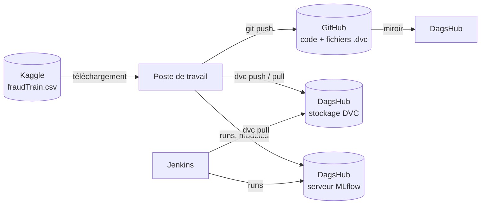

# Mise en place : GitHub, DVC et MLflow

Ce guide explique comment héberger le projet *Bank Fraud Detection MLOps* sur **votre propre
dépôt GitHub**, suivre les expériences avec **MLflow** et produire **à partir de zéro** les
données, les processeurs et le modèle, versionnés avec **DVC**.

Le dépôt ne contient au départ **ni données, ni modèle, ni fichier `.dvc`** : tout est produit
par les notebooks depuis le jeu de données Kaggle, puis versionné (§ 8).

| Parcours | Sections |
|---|---|
| **Enseignant, première fois** : créer le dépôt et la première version des données et du modèle | 3.1 → 4 → 5 → 6.1 → 7 → 8 |
| **Étudiant ou autre machine** : récupérer ce qui a déjà été versionné | 3.2 → 4 → 6.1 → 6.2 → 7 |

1. [Qui stocke quoi](#1-qui-stocke-quoi)
2. [Prérequis](#2-prérequis)
3. [Créer le dépôt GitHub](#3-créer-le-dépôt-github)
4. [Environnement Python](#4-environnement-python)
5. [Connecter DagsHub au dépôt GitHub](#5-connecter-dagshub-au-dépôt-github)
6. [Configurer DVC](#6-configurer-dvc)
7. [Configurer MLflow](#7-configurer-mlflow)
8. [Tout produire à partir de zéro (notebooks)](#8-tout-produire-à-partir-de-zéro-notebooks)
9. [Pipeline Jenkins](#9-pipeline-jenkins)
10. [Sécurité](#10-sécurité)
11. [Dépannage](#11-dépannage)

---

## 1. Qui stocke quoi

GitHub ne peut héberger ni des données de plusieurs gigaoctets (refus au-delà de 100 Mo par
fichier) ni un serveur MLflow. On lui associe **DagsHub**, qui se connecte à un dépôt GitHub et
fournit gratuitement un remote DVC et un serveur MLflow.

| Emplacement | Contenu | Versionné par |
|---|---|---|
| **GitHub** | code, notebooks (sans sorties), `.dvc/config` ; `data.dvc` et `artifacts.dvc` après le premier `dvc add` (§ 8.2) | Git |
| **DagsHub — stockage DVC** `https://dagshub.com/<user>/<repo>.dvc` | `data/` (CSV), `artifacts/` (processeurs, modèles, figures) | DVC |
| **DagsHub — serveur MLflow** `https://dagshub.com/<user>/<repo>.mlflow` | runs, métriques, modèles, Model Registry | MLflow |
| **Votre machine uniquement** | `.env` (tokens), `.dvc/config.local` (identifiants DVC), cache DVC | rien (ignoré par Git) |



Le fichier `data.dvc` (ou `artifacts.dvc`) est un petit fichier texte contenant le hash
`md5` du dossier : Git versionne ce hash, DVC stocke le contenu correspondant sur le remote.
Un commit Git désigne donc à la fois une version du code **et** une version exacte des données.
Ces deux fichiers n'existent pas dans un dépôt neuf : c'est `dvc add` qui les crée (§ 8.2).

---

## 2. Prérequis

- **Git**, et un compte **GitHub** ;
- **Python 3.12** (version utilisée pour les notebooks et l'image Docker du backend) ;
- un compte **DagsHub** (connexion possible avec le compte GitHub) ;
- un compte **Kaggle**, pour télécharger le jeu de données source (§ 8.1) ;
- **macOS** uniquement : `brew install libomp` (requis par LightGBM et XGBoost) ;
- environ **5 Go** d'espace disque (données, artefacts et cache DVC).

---

## 3. Créer le dépôt GitHub

### 3.1 Publier ce dossier dans un nouveau dépôt (enseignant)

1. Vérifier que rien de volumineux ou de secret ne sera publié :

   ```bash
   git status
   git check-ignore -v data artifacts .env books mlops.mp4   # chaque ligne doit afficher la règle qui ignore le chemin
   ```

2. Créer le dépôt GitHub et pousser. Avec la CLI GitHub (`gh auth login` au préalable) :

   ```bash
   git init -b main                     # seulement si le dossier n'est pas encore un dépôt Git
   git add . && git commit -m "chore: initialise le dépôt du cours"
   gh repo create <repo> --private --source=. --push       # ou --public
   ```

   Ou depuis le site : **New repository**, **sans** README, `.gitignore` ni licence (le dossier
   les contient déjà), puis :

   ```bash
   git remote add origin https://github.com/<user>/<repo>.git
   git push -u origin main
   ```

### 3.2 Récupérer le dépôt (étudiants, autre machine)

```bash
git clone https://github.com/<user>/<repo>.git
cd <repo>
```

Pour travailler sur votre propre copie, faites d'abord un **Fork** sur GitHub et clonez votre
fork ; connectez ensuite **votre** fork à DagsHub (étape 5).

---

## 4. Environnement Python

Depuis la racine du dépôt :

```bash
python3.12 -m venv .venv
source .venv/bin/activate          # Windows : .venv\Scripts\activate
pip install --upgrade pip
pip install -r requirements.txt    # ML, MLflow, DVC, Evidently, ipykernel, jupyterlab
```

Vérification :

```bash
dvc --version && mlflow --version && python -c "import lightgbm, xgboost, catboost; print('OK')"
```

---

## 5. Connecter DagsHub au dépôt GitHub

1. Se connecter sur [dagshub.com](https://dagshub.com) (**Sign in with GitHub**).
2. **Create → New Repository**, onglet **Connect a repository**, choisir **GitHub**, puis votre
   dépôt. DagsHub crée un dépôt du même nom, synchronisé avec GitHub.
3. Sur la page du dépôt DagsHub, le bouton **Remote** affiche les deux adresses à utiliser :
   - DVC : `https://dagshub.com/<user>/<repo>.dvc`
   - MLflow : `https://dagshub.com/<user>/<repo>.mlflow`
4. Créer un **token** : avatar → **Your settings → Tokens** (ou copier celui proposé dans la
   fenêtre **Remote**). Il sert de mot de passe pour DVC comme pour MLflow.
5. Créer le fichier `.env` à partir du modèle et le compléter :

   ```bash
   cp .env.example .env
   ```

   ```dotenv
   DAGSHUB_USER=<user>
   DAGSHUB_REPO=<repo>
   DAGSHUB_TOKEN=<token>
   MLFLOW_TRACKING_URI=https://dagshub.com/<user>/<repo>.mlflow
   MLFLOW_TRACKING_USERNAME=<user>
   MLFLOW_TRACKING_PASSWORD=<token>
   MLFLOW_EXPERIMENT_NAME=fraud_detection
   ```

   `.env` est ignoré par Git : il ne quitte jamais votre machine.

---

## 6. Configurer DVC

DVC lit deux fichiers de configuration :

| Fichier | Contenu | Commité ? |
|---|---|---|
| `.dvc/config` | nom et URL du remote | **oui** (partagé par toute l'équipe) |
| `.dvc/config.local` | utilisateur et token | **non** (ignoré par `.dvc/.gitignore`) |

### 6.1 Pointer le remote vers votre dépôt DagsHub

`.dvc/config` contient une URL **à compléter** (`<utilisateur-dagshub>/<depot-dagshub>`) :
la renseigner avec votre dépôt DagsHub.

```bash
dvc remote modify origin url https://dagshub.com/<user>/<repo>.dvc
dvc remote modify origin --local auth basic
dvc remote modify origin --local user <user>
dvc remote modify origin --local password <token>
dvc remote list                      # origin  https://dagshub.com/<user>/<repo>.dvc (default)

git add .dvc/config
git commit -m "dvc: utilise le remote DagsHub <user>/<repo>"
```

Le remote est encore **vide** : la première version des données et du modèle est produite et
envoyée au § 8. Les § 6.2 à 6.4 servent une fois cette version poussée.

### 6.2 Récupérer les données (étudiants, autre machine, CI)

Après avoir configuré les identifiants (`dvc remote modify origin --local user|password ...`) :

```bash
dvc pull                                   # tout : données + artefacts (≈ 2,3 Go)
dvc pull data/raws/fraud_600k.csv          # un seul fichier
dvc pull artifacts/preprocessing/ artifacts/mlflow/Best_Fraud_LightGBM/   # ce dont l'API a besoin
```

Si le dépôt DagsHub est **public**, `dvc pull` fonctionne sans identifiants ; `dvc push`
exige toujours un token avec droit d'écriture.

### 6.3 Cycle de travail quotidien

```bash
git pull
dvc pull                             # aligne data/ et artifacts/ sur les fichiers .dvc du commit

# ... modifier le code, exécuter les notebooks ...

dvc add data artifacts               # uniquement si des données ou artefacts ont changé
git add data.dvc artifacts.dvc notebooks/ ...
git commit -m "..."
dvc push                             # TOUJOURS avant git push
git push
```

> **Règle** : `dvc push` **avant** `git push`. Sinon, vos collègues récupèrent des fichiers `.dvc`
> qui pointent vers des données absentes du remote, et leur `dvc pull` échoue.

### 6.4 Revenir à une version antérieure des données

```bash
git log --oneline -- artifacts.dvc               # historique des versions des artefacts
git checkout <commit> -- data.dvc artifacts.dvc  # restaure les fichiers .dvc de ce commit
dvc checkout                                     # restaure les données correspondantes
```

---

## 7. Configurer MLflow

### 7.1 Serveur DagsHub (recommandé)

MLflow lit directement trois variables d'environnement : `MLFLOW_TRACKING_URI`,
`MLFLOW_TRACKING_USERNAME` et `MLFLOW_TRACKING_PASSWORD`. Les notebooks les chargent depuis
`.env` grâce à `notebooks/project_setup.py` : aucune adresse ni aucun identifiant n'est écrit
dans le code.

Pour un script lancé depuis un terminal, exporter le contenu de `.env` :

```bash
set -a; source .env; set +a
python -c "import mlflow; print([e.name for e in mlflow.search_experiments()])"
```

L'interface web se trouve à l'adresse `https://dagshub.com/<user>/<repo>.mlflow`
(onglet **Experiments** du dépôt DagsHub).

### 7.2 Mode local (sans compte, hors ligne)

Laisser `MLFLOW_TRACKING_URI` vide (ou ne pas créer de `.env`). Les notebooks enregistrent alors
les runs dans `mlflow.db` (SQLite, Model Registry compris) et les artefacts dans `mlruns/`, à la
racine du dépôt — deux chemins ignorés par Git. Pour consulter les résultats :

```bash
mlflow ui --backend-store-uri sqlite:///mlflow.db --port 5000      # http://127.0.0.1:5000
```

Pour partager un serveur sur le réseau de la salle :

```bash
mlflow server --backend-store-uri sqlite:///mlflow.db --host 0.0.0.0 --port 5000
# sur les postes étudiants : MLFLOW_TRACKING_URI=http://<ip-du-serveur>:5000
```

> Le pipeline Jenkins (champion / challenger, déploiement) lit le registre sur le serveur
> DagsHub : pour la boucle MLOps complète, exécuter les notebooks 03 et 04 avec MLflow sur
> DagsHub (§ 7.1).

### 7.3 Ce qui est enregistré

| Origine | Expérience MLflow | Contenu |
|---|---|---|
| Notebook 03 | `fraud_detection` (`MLFLOW_EXPERIMENT_NAME`) | un run par modèle : hyperparamètres, métriques `val_*`, modèle, commit Git, hash DVC des données ; métriques `test_*` sur le modèle retenu |
| Notebook 04 | Model Registry `Fraud_Detection_Production` | une version par promotion, alias `champion` |
| Jenkins (`train_model.py`) | `continuous_training_pipeline` | ré-entraînements automatiques après drift |

---

## 8. Tout produire à partir de zéro (notebooks)

À faire **une fois**, par l'enseignant, après les § 3.1 à 7. Les autres machines récupèrent
ensuite le résultat avec `dvc pull` (§ 6.2).

| Ordre | Notebook | Prérequis | Produit |
|---|---|---|---|
| 1 | `01_eda.ipynb` | `data/raws/fraud_1M.csv` | figures dans `artifacts/eda/` |
| 2 | `02_preprocessing.ipynb` | `fraud_1M.csv` (ou `fraud_600k.csv`) | `data/raws/fraud_600k.csv`, `artifacts/preprocessing/*.pkl` |
| 3 | `03_fraud_detection_modeling.ipynb` | sortie du 02, MLflow configuré | runs MLflow, `artifacts/modeling/` |
| 4 | `04_mlflow_tracking.ipynb` | runs du 03 | version du Model Registry, `artifacts/mlflow/Best_Fraud_LightGBM/` (modèle lu par l'API) |

Les notebooks localisent la racine du dépôt automatiquement : ils fonctionnent quel que soit le
dossier de lancement, sur toutes les machines.

### 8.1 Télécharger les données sources

Jeu Kaggle *Credit Card Transactions Fraud Detection* (`kartik2112/fraud-detection`). Seul
`fraudTrain.csv` (1 296 675 transactions) est utilisé ; il est enregistré sous
`data/raws/fraud_1M.csv`.

Depuis la page du jeu de données (bouton **Download**, puis décompresser l'archive) :

```bash
mkdir -p data/raws
mv ~/Downloads/fraudTrain.csv data/raws/fraud_1M.csv
```

Ou avec la CLI Kaggle (jeton : Kaggle › **Settings › API › Create New Token**, fichier
`kaggle.json` à placer dans `~/.kaggle/`, droits `600`) :

```bash
pip install kaggle
kaggle datasets download -d kartik2112/fraud-detection -p data/raws --unzip
mv data/raws/fraudTrain.csv data/raws/fraud_1M.csv
rm data/raws/fraudTest.csv                       # non utilisé par le projet
```

### 8.2 Notebooks 01 et 02, puis première version des données

```bash
jupyter lab notebooks/          # exécuter 01_eda puis 02_preprocessing (ou ouvrir le dossier dans VS Code)
```

Le notebook 02 extrait les 600 000 premières transactions (`fraud_600k.csv`), découpe
train / validation / test, ajuste les encodeurs et le scaler, puis applique SMOTE au train.
Versionner ensuite ce résultat :

```bash
dvc add data artifacts          # crée data.dvc et artifacts.dvc
git add data.dvc artifacts.dvc .gitignore
git commit -m "données : version initiale (Kaggle + préprocessing)"
dvc push                        # TOUJOURS avant git push
git push
```

Pourquoi versionner **avant** la modélisation : chaque run du notebook 03 enregistre le commit
Git et les hash `md5` lus dans `data.dvc` et `artifacts.dvc`. Les runs désignent ainsi une
version des données qui existe sur le remote.

### 8.3 Notebooks 03 et 04, puis version du modèle

Exécuter `03_fraud_detection_modeling` (un run MLflow par modèle), puis `04_mlflow_tracking`
(enregistrement du meilleur run sous `Fraud_Detection_Production`, alias `champion`, et export du
modèle servi dans `artifacts/mlflow/Best_Fraud_LightGBM/1.0.0/`). Puis :

```bash
dvc add artifacts
git add artifacts.dvc
git commit -m "modèle : premier champion"
dvc push
git push
```

Le dépôt est alors complet : l'API, les images Docker et les pipelines Jenkins trouvent leurs
artefacts avec `dvc pull`.

**Mode rapide.** Avec `QUICK_RUN=1` dans `.env`, le notebook 03 ne règle que LightGBM et
XGBoost, sur un échantillon plus petit, et saute les ensembles : quelques minutes au lieu de
plusieurs dizaines de minutes (voire plus d'une heure selon la machine) en mode complet. Les
autres options (`RUN_TUNING`, `RUN_ENSEMBLES`, `N_ITER`, `TUNING_MAX_ROWS`, `REBUILD_SUBSET`)
sont décrites dans `.env.example`.

**Sans interface Jupyter.** Les notebooks peuvent aussi s'exécuter en ligne de commande ; les
copies exécutées vont hors du dépôt, les notebooks versionnés restent sans sorties :

```bash
for nb in 01_eda 02_preprocessing; do        # puis : 03_fraud_detection_modeling 04_mlflow_tracking
  jupyter nbconvert --to notebook --execute --ExecutePreprocessor.timeout=-1 \
    --output-dir /tmp/notebooks-executes "notebooks/$nb.ipynb"
done
```

**Avant de commiter un notebook** ouvert dans Jupyter, retirer ses sorties (images lourdes,
conflits de fusion illisibles) :

```bash
pip install nbstripout
nbstripout --install                 # filtre Git : les sorties sont retirées automatiquement à chaque commit
```

> `data/raws/new_data.csv` (nouvelles transactions pour la détection de drift) n'appartient pas à
> la version initiale : il se fabrique pour la démonstration avec `python jenkins/simulate_new_data.py`
> (README principal, étape 8).

---

## 9. Pipeline Jenkins

Prérequis : la première version des données et du modèle a été poussée (§ 8), car les deux
pipelines commencent par un `dvc pull`.

Les pipelines lisent le token dans le *credential* Jenkins `dagshub-token` (Secret text). Pour les
faire pointer vers votre dépôt DagsHub, il suffit de changer **deux variables** en tête de
`jenkins/Jenkinsfile.ml.txt` et de `jenkins/Jenkinsfile.deploy.txt` :

```groovy
DAGSHUB_USER = '<utilisateur-dagshub>'   // votre utilisateur DagsHub
DAGSHUB_REPO = '<depot-dagshub>'         // votre dépôt DagsHub
```

L'URI MLflow, l'utilisateur MLflow et l'utilisateur DVC en sont dérivés. L'URL du remote DVC est
lue dans `.dvc/config` : elle est à jour dès que l'étape 6.1 est commitée.

Autres réglages du pipeline ML (bloc `environment`) :

| Variable | Rôle | Défaut |
|---|---|---|
| `API_URL` | API vue depuis Jenkins (NodePort minikube) | `http://192.168.49.2:30080` |
| `PUSHGATEWAY_URL` | Pushgateway vu depuis Jenkins | `http://192.168.49.2:30091` |
| `MIN_DETECTED` | quality gate du test de scénario (fraudes détectées sur 11) | `9` |
| `API_ADMIN_TOKEN` | jeton des endpoints d'écriture de l'API (credential `fraud-api-admin-token`) | désactivé |

Le pipeline de déploiement a aussi besoin du credential `dockerhub-credentials` (Username/Password).

---

## 10. Sécurité

- Les tokens ne vont que dans `.env` et `.dvc/config.local`, tous deux ignorés par Git. Vérifier
  avant chaque premier push : `git check-ignore -v .env .dvc/config.local`.
- Ne jamais utiliser `dvc remote modify` **sans** `--local` pour `user` ou `password` : la valeur
  serait écrite dans `.dvc/config`, donc publiée.
- Un token publié par erreur doit être **révoqué** sur DagsHub (Settings → Tokens) : le retirer du
  fichier ne suffit pas, il reste dans l'historique Git.
- Le webhook Slack d'Alertmanager n'est jamais dans le dépôt : il est injecté au déploiement
  depuis `SLACK_WEBHOOK_URL` (voir `k8s/monitoring/alertmanager-config.template.yaml`).
- Les endpoints d'écriture de l'API (`/update-drift-metrics`, `/upload-drift-report`) peuvent être
  protégés par un jeton : secret Kubernetes `fraud-api-secrets` côté API, credential
  `fraud-api-admin-token` côté Jenkins (README principal, § Sécurité).
- Les dossiers `books/` (PDF commerciaux) et les vidéos (`*.mp4`) sont exclus du dépôt.

---

## 11. Dépannage

| Symptôme | Cause probable | Solution |
|---|---|---|
| `dvc pull` : `... does not exist as an output or a stage name` | aucune version poussée : pas encore de `data.dvc` / `artifacts.dvc` | produire la première version (§ 8) |
| `dvc pull` : `401 Unauthorized` | identifiants absents ou token expiré | `dvc remote modify origin --local user/password ...` |
| `dvc push` : `403 Forbidden` | token sans droit d'écriture, ou dépôt d'un autre utilisateur | utiliser votre propre dépôt DagsHub et votre token |
| `dvc pull` : `missing cache files` | quelqu'un a fait `git push` sans `dvc push` | lui demander de lancer `dvc push` |
| `FileNotFoundError ... fraud_1M.csv` | données sources absentes | première fois : § 8.1 (Kaggle) ; sinon `dvc pull data/` |
| `kaggle` : `401` ou `Could not find kaggle.json` | jeton Kaggle absent | § 8.1 (`~/.kaggle/kaggle.json`, droits `600`) |
| MLflow : `401` ou `403` | variables `MLFLOW_TRACKING_*` non chargées | vérifier `.env` ; dans un terminal, `set -a; source .env; set +a` |
| Les runs apparaissent dans `mlflow.db` au lieu de DagsHub | `MLFLOW_TRACKING_URI` vide ou `.env` absent | compléter `.env`, redémarrer le noyau Jupyter |
| `Library not loaded: libomp.dylib` (macOS) | OpenMP manquant | `brew install libomp` |
| GitHub refuse le push (`file exceeds 100 MB`) | fichier volumineux ajouté à Git au lieu de DVC | `git rm --cached <fichier>`, puis `dvc add <fichier>` |
